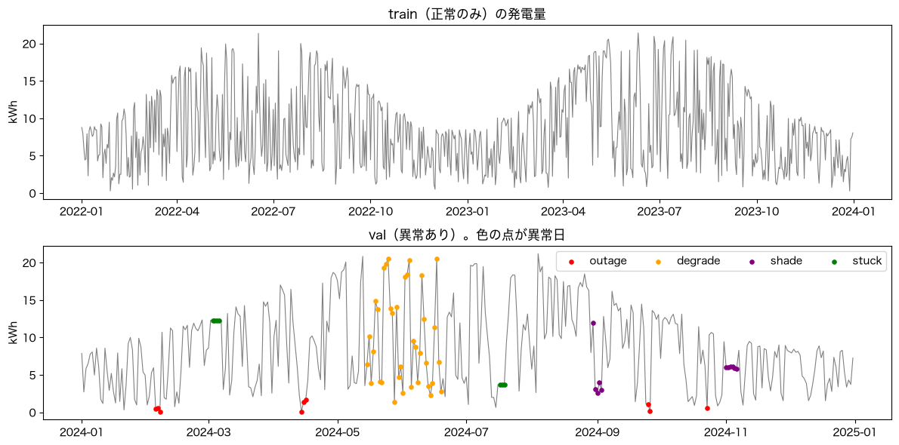
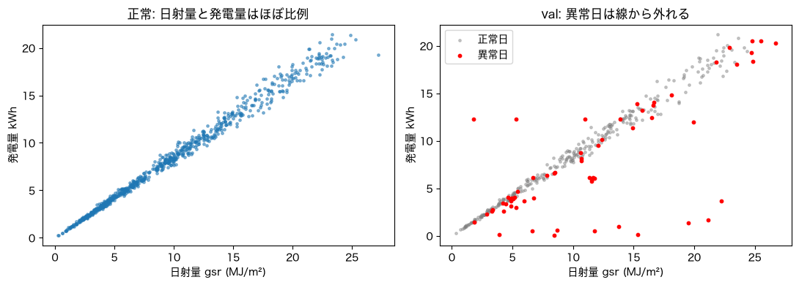
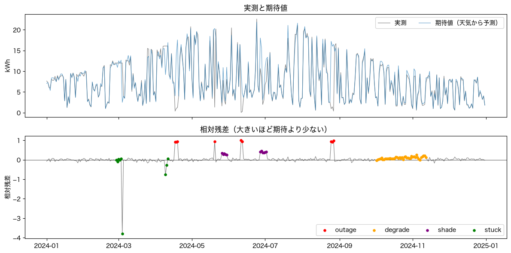
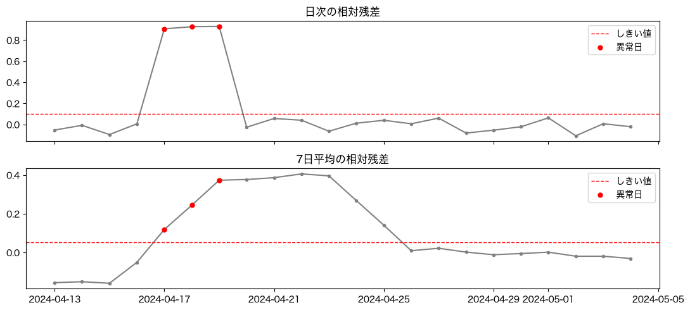
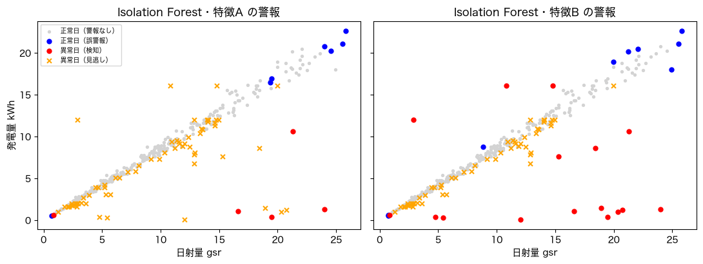
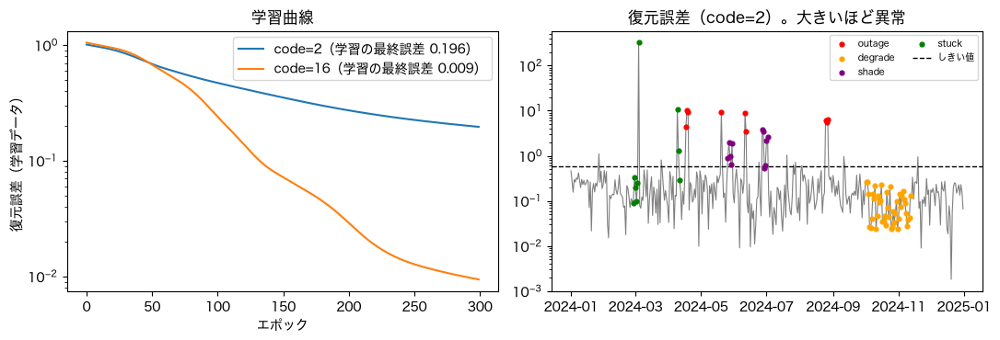
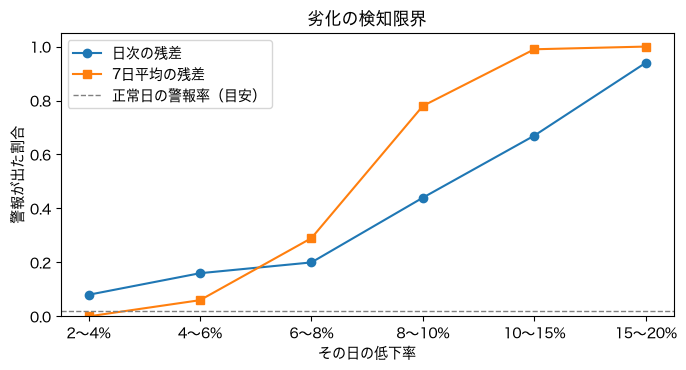

# notebooks — 演習の実行結果まとめ

日次の太陽光発電量から**「いつもと違う日」（異常）を見つける**方法を、7本のNotebook（00〜06）で学ぶ演習です。
このページは、各Notebookを**実行したときに何が起こり、何が分かるか**を、結果の図・表つきでまとめたものです。
**Notebookを開く前の予習**にも、**実行後の答え合わせ**にも使えます。

## このページの見方

- 図・表の数値は、**合成データ**（プログラムで作った発電量。固定シードで毎回同じ）に対する結果です。
  特に断りがなければ、評価は **val の10系列（index=1〜10）の合計または平均**です。
- 「**条件を1つだけ変える**」実験です。手法が変わったのか、設定が変わったのかを区別するためです。
- `±` や `sd` は**ばらつき（標準偏差）**です。**手法の差がこの値より小さいときは、差があるとは言えません**。
- 数値は、各Notebookを実行したときの出力と同じです。乱数やライブラリのバージョンで、小数点以下が少しずれることがあります。**傾向**が同じであることを確認してください。
- 実データ（自宅の発電量）を扱うのは**最後のNotebookだけ**です。個人データなので、日付や個別の値は載せず、**件数や傾向だけ**を載せています。
- 用語が分からないときは、すぐ下の「用語集」を見てください。
- 詳しい考察は [../MANUAL.md](../MANUAL.md)、最終レポートは [../REPORT.md](../REPORT.md) にあります。

## 用語集

分からなくなったら、ここに戻ってきてください。

### 異常と正常

| 用語 | やさしい説明 |
|---|---|
| **異常検知** | 「いつもと違うもの」を見つけること。異常の見本がほとんど無いのが普通なので、**正常を学んで、そこから外れたものを探す** |
| **異常日** | 異常が起きている日。このプロジェクトでは、**自分で注入した**ので、どの日かが正解として分かる |
| **注入** | 正常なデータに、わざと異常を混ぜること。混ぜた場所が分かるので、**答え合わせ**ができる |
| **停電（outage）** | 発電がほぼ止まる異常（本来の0〜10%）。易しい |
| **劣化（degrade）** | 汚れや劣化で、**30〜50日かけて徐々に**発電量が下がる異常。難しい |
| **影（shade）** | 一定期間、発電量が一定の割合で下がる異常（既定は2〜4割低下） |
| **固着（stuck）** | 計測値が**同じ値のまま動かない**異常（天気は変わるのに発電量が変わらない） |
| **共変量** | 発電量を説明する別の情報（日射量・日照率・天気など） |
| **日射量（gsr）** | 太陽の光の強さ（MJ/m²）。発電量はほぼこれに比例する |

### 学習と評価の考え方

| 用語 | やさしい説明 |
|---|---|
| **教師なし** | 「これが異常」という正解を使わずに学ぶこと。現実の異常検知は、ほぼこれ |
| **正常データだけで学習** | 異常を含まないデータで「普通」を学び、異常は**評価にだけ**使う原則 |
| **train / val / test** | train＝学習用（正常のみ）、val＝しきい値や手法を決める用、test＝**最後に1回だけ**成績をつける本番用 |
| **時間順の分割** | 未来のデータを学習に使わないよう、日付の順に分けること |
| **ホールドアウト（out-of-fold）** | 学習に**使わなかった**データで評価すること。しきい値は、学習に使っていない年のスコアで決める |
| **過学習** | 学習に使ったデータには合うが、新しいデータには合わないこと |
| **シード（乱数の種）** | 乱数の出方を決める番号。同じ番号なら同じ結果になる |

### 検知の仕組み

| 用語 | やさしい説明 |
|---|---|
| **異常スコア** | 異常っぽさを表す数字。**大きいほど異常** |
| **しきい値** | スコアがこれを超えたら**警報**を出す境目。このプロジェクトでは「正常な日に警報が出る割合を約3%（約1か月に1回）」になるよう、正常データのスコアで決める |
| **期待発電量** | 天気（日射量など）から予測した、「正常ならこのくらい」の発電量 |
| **残差** | 期待と実測の差。**相対残差 =（期待 − 実測）÷ 期待**。大きいほど「期待より少ない」 |
| **MAD** | 外れ値に強い「ばらつき」の指標。これが大きいほど、小さな異常は見つけにくい |
| **平滑化（7日平均）** | 直近7日の平均を取ること。徐々に進む変化が見えやすくなる |
| **余韻** | 平滑化のせいで、**異常が終わった後も数日、警報が出続けること** |
| **特徴量** | 手法に渡す数値。何を渡すかが、結果を大きく左右する |
| **Isolation Forest** | データをランダムに分割していき、**少ない分割で孤立する点ほど異常**とみなす手法 |
| **LOF（局所外れ値因子）** | ある点の周りの密度を、近くの点と比べ、**周りより疎な点ほど異常**とみなす手法 |
| **オートエンコーダ** | 入力を細い通路に**圧縮してから元に戻す**ネットワーク。復元できない日を異常とする |
| **復元誤差** | 入力と、復元した出力との差。オートエンコーダの異常スコア |
| **汚染** | 学習データに**異常が混ざる**こと。現実の「正常データ」は完全に正常とは限らない |

### 評価の指標

| 用語 | やさしい説明 |
|---|---|
| **誤警報** | 正常な日に出してしまった警報。多いと、警報が信用されなくなる。「月あたり件数」で見る |
| **適合率** | 警報を出した日のうち、本当に異常だった割合 |
| **検知率（イベント単位）** | 異常イベント（例: 3日間の停電）のうち、**期間中に1回でも警報が出た**割合 |
| **検知率（日単位）** | 異常日のうち、**警報が出た日**の割合 |
| **検知までの日数** | 異常が始まってから、最初の警報までの日数 |
| **偶然の水準** | 警報がでたらめに出ても、検知に数えられる確率。**長い異常ほど高い**（劣化は約0.64）。警報がまとまって出る検知器では目安にすぎない |
| **AUPRC** | しきい値を動かしたときの、適合率と検知率の総合的な良さ（0〜1）。1に近いほど良い |
| **検知限界** | これより小さい異常は見つけられない、という境目 |
| **感度分析** | 異常の大きさなどを変えて、結果がどう変わるかを調べること |
| **最終評価** | 手法・しきい値を**すべて決めた後**、未使用の test で**1回だけ**行う評価 |

---

## 全体の流れ

| Notebook | 答える問い | 結論（一言） |
|---|---|---|
| [00_synthetic_data](00_synthetic_data.ipynb) | 使うデータは？ 「少ない」は異常？ | 異常は4種類。**天気で説明できない**ずれが異常。答えの列は検知器に渡さない |
| [01_baselines](01_baselines.ipynb) | 簡単な方法はどこで失敗する？ | 天気を考えないと、**停電しか見つからず**、雨の日を異常と誤る。長い異常は偶然でも「検知」に数えられる |
| [02_residual](02_residual.ipynb) | 天気から期待値を作ると？ | 停電・影は確実。劣化も偶然を超えて見つかる。**平滑化は余韻**で誤警報が増えて見える |
| [03_unsupervised](03_unsupervised.ipynb) | 期待値モデルなしでも見つかる？ | **特徴量（天気に対する比）を教えれば**残差法に近づく。手法の差より特徴量の差が大きい |
| [04_autoencoder](04_autoencoder.ipynb) | 深層学習は役に立つ？ | 残差法に及ばず、**シードでぶれる**。学習データに異常が混ざると**異常を覚えて悪化** |
| [05_combined_limits](05_combined_limits.ipynb) | 組み合わせるとどこまで？ 限界は？ | **日次の残差＋固着ルール**で全種類をイベント検知。劣化は**6〜8%の低下から**、弱い影は見逃す |
| [06_real_data](06_real_data.ipynb) | 実データでも通用する？ | **ノイズが約5倍荒く**、検知限界が悪化。候補15日は**すべて正常**。水準別に標準化した残差が有効 |

---

## 00. 合成データを見る — [00_synthetic_data.ipynb](00_synthetic_data.ipynb)

**このNotebookのゴール**: このプロジェクトで使う**合成の日次発電量**の中身を理解する。「発電量が少ない」ことと「異常」が**違う**ことを、データで確かめる。

**やること**
1. データを読み込んで表を見る
2. 発電量の時系列を描く
3. 天気と発電量の関係を見る（少ない＝異常ではない）
4. 異常の種類ごとに、正常だった場合の値と比べる

### 実行結果

**データの形**（学習用 train 730日・確認用 val 366日。val の先頭3日を抜粋）:

| date | weather_class | sunshine_ratio | gsr | gen_kwh | gen_clean_kwh | is_anomaly | anomaly_type |
|---|---|---|---|---|---|---|---|
| 2024-01-01 | 0 | 0.939 | 8.95 | 7.85 | 7.85 | 0 | none |
| 2024-01-02 | 1 | 0.331 | 3.14 | 2.70 | 2.70 | 0 | none |
| 2024-01-03 | 1 | 0.691 | 7.01 | 5.81 | 5.81 | 0 | none |

`gen_kwh` が観測された発電量。`gen_clean_kwh`・`is_anomaly`・`anomaly_type` は**答え合わせ用**で、検知器には渡しません。

**発電量の時系列**（上: 正常のみの train ／ 下: 異常を混ぜた val。色の点が異常日）



**天気ごとの発電量**（正常データ。天気 0=晴・1=曇・2=雨）

| 天気 | 日数 | 平均 | 最小 | 最大 |
|---|---|---|---|---|
| 晴 | 250 | 13.2 | 7.1 | 21.4 |
| 曇 | 243 | 8.4 | 2.2 | 18.0 |
| 雨 | 237 | 3.3 | 0.3 | 9.2 |

**日射量と発電量**（左: 正常はほぼ1本の線 ／ 右: val の異常日（赤）は線から外れる）



**異常の種類ごとの「観測値 ÷ 異常がなかった場合の値」**（val）

| 種類 | 異常の数 | 異常日数 | 比の最小 | 比の平均 | 比の最大 |
|---|---|---|---|---|---|
| outage（停電） | 4 | 9 | 0.01 | 0.06 | 0.10 |
| degrade（劣化） | 1 | 36 | 0.91 | 0.94 | 0.98 |
| shade（影） | 2 | 11 | 0.62 | 0.65 | 0.69 |
| stuck（固着） | 2 | 7 | 0.18 | 2.18 | 8.29 |

**固着の前後**（固着中は発電量が `12.27` のまま。日射量と天気は変わり続ける）

| date | gsr | weather_class | gen_kwh | anomaly_type |
|---|---|---|---|---|
| 2024-03-02 | 14.06 | 0 | 12.27 | none |
| 2024-03-03 | 5.28 | 1 | 12.27 | stuck |
| 2024-03-04 | 1.82 | 2 | 12.27 | stuck |
| 2024-03-05 | 13.89 | 0 | 12.27 | stuck |
| 2024-03-06 | 11.00 | 1 | 12.27 | stuck |
| 2024-03-07 | 15.72 | 0 | 12.20 | none |

### 読み取れること
- 夏に多く冬に少ない**季節の波**の上で、天気のせいで日々大きく上下する。色を消して眺めると、多くの異常は「ただの曇りの日」と**見分けがつかない**。ここが異常検知の難しさ。
- 雨の日の平均は晴れの日の約4分の1。**雨で少ないのは正常**なので、「小さい値＝異常」のルールにすると、雨の日をすべて誤って警報にする。
- 日射量と発電量は**ほぼ比例**する（左図）。この関係から外れた日が異常。**停電と影は線のかなり下**に出る。一方、**劣化は線のすぐ近く**、**固着は線の下にも上にも**散らばる（右図）。
- 異常の種類で、見つけやすさが違う。停電は易しく、劣化は徐々に進むため正常のばらつきに紛れ、固着は**値の大きさに特徴がない**（比が0.18〜8.29）。
- 固着は、天気が変わるのに発電量が変わらないことがサイン。

### 演習
- `val["is_anomaly"].mean()` で異常日の割合を確認する（約15〜17%。現実の1〜3%より**多め**。評価の統計を取るため）
- `make_split("val", 1)` に変えて、別の系列を見る（異常の位置が変わる）
- `make_split("val", 0, {"outage": 2})` のように異常の数を指定して、図の見え方を比べる

---

## 01. 非AIのベースライン — [01_baselines.ipynb](01_baselines.ipynb)

**このNotebookのゴール**: AIを使わない**簡単な検知方法**を作り、何が見つかり、何が見つからないかを知る。**検知率が偶然でも高く出る**ことを理解する。

**やること**
1. 素朴な固定ルール（3kWh未満なら警報）を試す
2. 正常データ（train）だけでしきい値を決める検知器を作る
3. 10本の系列で評価し、異常の種類ごとの検知率を見る
4. 「偶然でも検知に数えられる確率」と比べる

### 実行結果

**素朴ルール「3kWh未満なら警報」**（val の1系列）

```
警報の日数: 75
  うち正常日（誤警報）: 48 ／ そのうち雨の日: 46
  うち異常日: 27 ／ 異常日の合計: 71
雨の正常日: 111 日
```

**しきい値を「正常日の警報率3%」に揃えた検知器**（val の1系列）

| 検知器 | しきい値 | 警報日数 | 誤警報（月） | 適合率 |
|---|---|---|---|---|
| 固定しきい値（低い値） | -1.335 | 22 | 1.22 | 0.45 |
| 移動平均からの落ち込み | 0.829 | 15 | 0.61 | 0.60 |
| 季節平均との比 | 0.812 | 20 | 0.81 | 0.60 |
| 固着ルール（同値連続） | 1.000 | 10 | 0.00 | 1.00 |

**10系列の平均（±標準偏差）**

| 検知器 | 誤警報（月） | AUPRC |
|---|---|---|
| 固定しきい値 | 1.00 ±0.30 | 0.322 ±0.049 |
| 移動平均からの落ち込み | 0.72 ±0.23 | 0.341 ±0.040 |
| 季節平均との比 | 0.97 ±0.36 | 0.348 ±0.045 |
| 固着ルール | 0.01 ±0.03 | 0.293 ±0.028 |
| 素朴ルール（3kWh未満） | **4.55** ±0.94 | 0.322 ±0.049 |

**検知率（イベント単位 / 日単位）**

| 検知器 | 停電 | 影 | 固着 | 劣化 |
|---|---|---|---|---|
| 固定しきい値 | 1.0 / 0.94 | 0.30 / 0.07 | 0.05 / 0.04 | 0.7 / 0.04 |
| 移動平均からの落ち込み | 1.0 / 0.92 | 0.30 / 0.06 | 0.05 / 0.03 | 0.8 / 0.05 |
| 季節平均との比 | 1.0 / 0.99 | 0.30 / 0.06 | 0.05 / 0.04 | 0.9 / 0.06 |
| 固着ルール | 0.0 / 0.00 | 0.00 / 0.00 | **1.0 / 1.00** | 0.2 / 0.01 |
| 素朴ルール | 1.0 / 1.00 | 0.65 / 0.24 | 0.10 / 0.11 | 1.0 / 0.17 |

**偶然の水準**（警報がでたらめに出ても、検知に数えられる確率）: 劣化 **0.64** ／ 影 0.14 ／ 固着 0.13 ／ 停電 0.06

**検知までの日数**（検知できたイベントの平均。しきい値を揃えた3つの方法）: 停電はほぼ0日、影は約1日、劣化は**約16〜18日**

### 読み取れること
- 素朴ルールは、警報75日のうち**48日が誤警報**で、うち46日は雨の日。雨で発電が少ないのは正常なので、**天気を考えないと雨を異常と間違える**。
- しきい値を揃えた3つの方法は、誤警報が月1回前後に収まるが、**適合率は0.45〜0.6**。警報の半分近くは誤り。
- **停電は、固着ルール以外すべてで見つかる**（易しい）。**固着は、固着ルールだけが1.0**で、値の大きさを見る方法では0.05。
- **劣化と影は、ほぼ見つかっていない**。日単位の検知率（影0.06〜0.07、劣化0.04〜0.06）が、誤警報率の3%とほとんど変わらない。
- **劣化のイベント単位0.7〜0.9は、偶然の水準0.64と大差がない**。長い異常は、警報が1回でも出れば「検知」になるので、数字が良く見える。検知までの日数が約17日と長いのも、偶然に近い証拠。
- 3つの方法のAUPRC（0.32〜0.35）の差は、ばらつきの範囲内。**差があるとは言えない**。

### 演習
- `RATE = 0.03` を `0.10` に変えて、影と劣化の検知率がどれだけ上がるか見る（誤警報と引き換え）
- 移動平均の窓 `window=7` を `3` と `30` に変えて、異常の種類ごとの検知率を比べる
- `EVAL_INDEXES` を別の範囲（11〜20）にして、結果が似ているか確かめる

---

## 02. 期待値との残差で検知する — [02_residual.ipynb](02_residual.ipynb)

**このNotebookのゴール**: 日射量から**期待発電量**を予測し、実測との**残差**で異常を検知する。天気を考えない方法と何が違うかを確かめる。**平滑化が生む余韻**を理解する。

**やること**
1. 正常データ（train）で「期待発電量」のモデルを学習する
2. 実測との残差（相対残差）を見る
3. しきい値を、学習に使っていない年の残差で決める理由を確かめる
4. 3種類の期待値モデル × 平滑化なし/7日平均 を、10系列で比べる

### 実行結果

**期待値モデル**（日射量だけから発電量を予測する直線）: 傾き **0.844** kWh／(MJ/m²)、切片 0.062（データを作ったときの換算係数は0.85）

**実測と期待値、相対残差**（val の1系列。色の点が異常日）



**残差のばらつき**（正常データの相対残差の標準偏差）

| 期待値モデル | 学習に使った年 | 学習に使っていない年 |
|---|---|---|
| linear_gsr（日射量のみ） | 0.0564 | 0.0565 |
| linear_all（日射量＋日照率＋天気） | 0.0556 | 0.0559 |
| rf（RandomForest） | **0.0519** | **0.0707** |

**6つの検知器（10系列の平均）**

| 検知器 | 誤警報（月） | 余韻を除く誤警報 | 適合率 | AUPRC |
|---|---|---|---|---|
| 線形（gsrのみ）・日次 | 0.85 | 0.81 | 0.78 | **0.687** |
| 線形（全特徴）・日次 | 1.06 | 1.02 | 0.74 | 0.686 |
| RandomForest・日次 | 1.11 | 1.10 | 0.73 | 0.670 |
| 線形（gsrのみ）・7日平均 | **4.40** | 0.47 | 0.46 | 0.360 |
| 線形（全特徴）・7日平均 | 4.41 | 0.55 | 0.46 | 0.358 |
| RandomForest・7日平均 | 4.35 | 0.52 | 0.45 | 0.352 |

**検知率（イベント単位 / 日単位）**

| 検知器 | 停電 | 影 | 固着 | 劣化 |
|---|---|---|---|---|
| 線形（gsrのみ）・日次 | 1.0 / 1.0 | 1.0 / 1.00 | 0.55 / 0.36 | 1.0 / 0.29 |
| RandomForest・日次 | 1.0 / 1.0 | 1.0 / 1.00 | 0.55 / 0.35 | 1.0 / 0.29 |
| 線形（gsrのみ）・7日平均 | 1.0 / 1.0 | 1.0 / 0.87 | 0.35 / 0.22 | 1.0 / **0.58** |
| RandomForest・7日平均 | 1.0 / 1.0 | 1.0 / 0.84 | 0.30 / 0.21 | 1.0 / 0.52 |

**検知までの日数**: 停電・影は0日、固着は約1日、劣化は**日次で約7日・7日平均で約11〜13日**。

**停電の前後を拡大**（上: 日次の相対残差 ／ 下: 7日平均。停電が終わった後も、7日平均はしきい値を超えたまま）



### 読み取れること
- 天気で上下する実測を、**期待値がほぼ追いかける**。残差を見ると、正常日はほぼ0の周りに収まり、**停電と影は大きく外れる**。Notebook 01 では見分けられなかった異常が、はっきり見える。
- **AUPRCは0.67〜0.69**と、天気を考えない方法（0.32〜0.35）の**約2倍**。影は日単位1.0（01では0.07）。
- 3つの期待値モデルの差は、ばらつきの範囲内。このデータは日射量とほぼ比例する単純な構造なので、**複雑なモデルは不要**。残差の大きさは、データのノイズ（発電約3%＋日射計測約4%）で決まる。
- **RandomForestは過学習**する。学習に使った年の残差は0.052と小さく、使っていない年は0.071。学習に使った年でしきい値を決めると、新しいデータで誤警報が増えるので、**学習に使っていない年**で決める。
- **7日平均は劣化に効く**（日単位0.29→0.58）が、**検知まで約11日**かかり、固着は**悪化**する（値が動かない異常は、平均を取ると薄まる）。
- **余韻**: 7日平均の誤警報は月4.4回に見えるが、異常直後の7日を除くと約0.5回。原因は、**異常が終わった後も警報が居残る**こと（下図）。
- 固着は残差では見つけにくい（日次0.55）。専用ルールが必要。

### 演習
- 残差のばらつきを表にしたセルで、`out_of_fold_residual` を学習に使った年の残差に置き換えて、RandomForest の0.052と0.071の違いを確かめる
- `CONFIGS` の窓 `7` を `3` と `14` に変えて、劣化の検知率と余韻の長さの関係を見る
- `run(rate=0.01)` と `run(rate=0.10)` で、誤警報の目標を変えたときの劣化と固着の検知率を比べる

---

## 03. 教師なし手法 — [03_unsupervised.ipynb](03_unsupervised.ipynb)

**このNotebookのゴール**: **Isolation Forest** と **LOF** で、期待値モデルを作らずに異常を検知する。**特徴量の作り方**で結果が大きく変わることを理解する。

**やること**
1. 3通りの特徴量（A: 素の値 / B: ＋発電量÷日射量の比 / C: ＋比の7日平均と前日差）を見る
2. 2手法 × 3特徴量を、02と同じ条件で評価する
3. 「異常のない系列」で、しきい値が狙いどおりに働くかを確かめる

### 実行結果

**特徴量セット**

| セット | 内容 | 列 |
|---|---|---|
| A | 素の値 | gen, gsr, sun, weather, season |
| B | A＋発電量/日射量の比 | A ＋ ratio |
| C | B＋比の7日平均＋前日との差の絶対値 | B ＋ ratio_7d, diff_prev |

**Isolation Forest・特徴Aと特徴Bの警報**（散布図。青=誤警報、赤=検知、×=見逃し）



**手法×特徴量の比較（10系列の平均）**

| 検知器 | 誤警報（月） | 余韻を除く誤警報 | 適合率 | AUPRC（±sd） |
|---|---|---|---|---|
| IsolationForest・特徴A | 0.81 | 0.80 | 0.33 | 0.275 ±0.051 |
| IsolationForest・特徴B | 0.73 | 0.69 | 0.72 | 0.530 ±0.075 |
| IsolationForest・特徴C | 2.47 | 0.69 | 0.52 | 0.511 ±0.083 |
| LOF・特徴A | 1.19 | 1.20 | 0.60 | 0.438 ±0.064 |
| LOF・特徴B | 1.53 | 1.54 | 0.68 | **0.649** ±0.062 |
| LOF・特徴C | 4.52 | 0.55 | 0.42 | 0.473 ±0.045 |
| （参考）残差法・線形gsr・日次 | 0.85 | 0.81 | 0.78 | 0.687 ±0.057 |

**検知率（イベント単位 / 日単位）**

| 検知器 | 停電 | 影 | 固着 | 劣化 |
|---|---|---|---|---|
| IsolationForest・A | 0.4 / 0.22 | 0.15 / 0.03 | 0.25 / 0.12 | 0.5 / 0.02 |
| IsolationForest・B | 1.0 / 1.00 | 0.75 / 0.45 | 0.90 / 0.59 | 0.7 / 0.04 |
| LOF・A | 0.9 / 0.91 | 0.70 / 0.32 | 0.95 / 0.57 | 0.8 / 0.05 |
| LOF・B | 1.0 / 1.00 | 1.00 / 1.00 | 1.00 / 0.77 | 1.0 / 0.22 |
| LOF・C | 1.0 / 1.00 | 1.00 / 0.99 | 0.95 / 0.82 | 0.9 / 0.26 |
| （参考）残差法・日次 | 1.0 / 1.00 | 1.00 / 1.00 | 0.55 / 0.36 | 1.0 / 0.29 |

**異常のない系列で、正常日に警報が出る割合**（狙いは0.03）

| 手法 | 特徴A | 特徴B | 特徴C |
|---|---|---|---|
| Isolation Forest | 0.028 | 0.025 | 0.024 |
| LOF | 0.040 | **0.052** | 0.019 |

### 読み取れること
- **特徴Aは弱い**。素の値だけでは「**値が珍しい日**」を異常とみなすので、**晴天の夏の日のような珍しいだけの正常日**が誤警報になり、**値は普通だが日射量の割に低い日**（影・劣化）を見逃す（左図: 誤警報は散布図の端、×の見逃しが中央に多い）。
- **比を足すと大きく改善**する（IFのAUPRC 0.275→0.530、LOF 0.438→0.649）。右図のように、発電量と日射量の関係から外れた日が見つかる。**異常とは「珍しい」ことではなく「天気の割におかしい」こと**で、それを教えないと手法は珍しさしか見ない。
- **手法の差（IFかLOFか）より、特徴量の差（AかBか）がずっと大きい**。教師なし手法でも、人が「天気に対する比を見る」ことを教えている。
- **固着は、LOFの方が残差法より見つけやすい**（日単位0.77〜0.82 対 0.36）。天気が変わるのに発電量が変わらない組み合わせが、正常データに無いパターンになるため（推測）。
- **特徴C（7日平均を含む）は、余韻**で誤警報が増えて見える（IF 2.47、LOF 4.52）。異常直後7日を除くと0.69と0.55に下がる。
- **LOFは、しきい値が狙いどおりに働かない**。特徴Bで異常のない系列の警報率が0.052（狙い0.03）。しきい値を決めるときの学習量（1年分）と最終モデル（2年分）で、スコアの分布が変わるため（推測）。
- 劣化は、どの手法でも日単位0.2前後以下。

### 演習
- 比 `ratio` を差（`gen - 0.85 * gsr`）に変えて、AUPRCの違いを見る
- LOFの近傍数 `n_neighbors=20` を `5` と `100` に変えて、影と固着の検知率、異常のない系列の警報率を比べる
- 最後のセルで、しきい値を学習に使ったデータのスコアで決めて、警報率の狙いからのずれを確かめる

---

## 04. オートエンコーダ — [04_autoencoder.ipynb](04_autoencoder.ipynb)

**このNotebookのゴール**: **オートエンコーダ**（深層学習）で異常を検知する。**異常を覚えてしまう落とし穴**を、実験で確かめる。

**やること**
1. オートエンコーダを学習し、学習曲線を見る
2. 復元誤差（異常スコア）の時系列を見る
3. 圧縮の細さ・入力の窓・学習データの汚れを変えて、10系列×3シードで評価する
4. 学習データに異常が混ざると何が起きるかを確かめる

### 実行結果

**学習曲線（左）と復元誤差の時系列（右。code=2。色の点が異常日）**



**6つの設定の比較（10系列×3シード）**

| 設定 | 誤警報（月） | 余韻を除く | 適合率 | AUPRC（±sd） | シード間のsd |
|---|---|---|---|---|---|
| AE・1日・code2 | 0.83 | 0.81 | 0.77 | 0.615 ±0.082 | 0.069 |
| AE・1日・code4 | 0.64 | 0.60 | 0.77 | 0.505 ±0.074 | 0.054 |
| AE・1日・code16（太い） | 1.17 | 1.22 | 0.67 | 0.550 ±0.056 | 0.027 |
| AE・7日窓・code4 | **4.76** | 0.71 | 0.33 | 0.287 ±0.057 | 0.004 |
| AE・7日窓・code16（太い） | 4.49 | 0.63 | 0.33 | 0.303 ±0.051 | 0.011 |
| AE・1日・code4・汚染学習 | 0.46 | 0.46 | 0.68 | **0.383** ±0.111 | 0.112 |
| （参考）残差法・線形gsr・日次 | 0.85 | 0.81 | 0.78 | 0.687 ±0.057 | — |

**検知率（イベント単位 / 日単位）**

| 設定 | 停電 | 影 | 固着 | 劣化 |
|---|---|---|---|---|
| 1日・code2 | 1.00 / 1.00 | 0.98 / 0.90 | 1.00 / 0.74 | 0.73 / 0.12 |
| 1日・code4 | 0.96 / 0.96 | 0.78 / 0.47 | 0.95 / 0.66 | 0.50 / 0.04 |
| 1日・code16 | 1.00 / 1.00 | 1.00 / 0.74 | 0.95 / 0.69 | 0.83 / 0.06 |
| 7日窓・code4 | 1.00 / 1.00 | 0.87 / 0.73 | 0.95 / 0.73 | 0.40 / 0.05 |
| 1日・code4・汚染学習 | 0.75 / 0.72 | 0.32 / 0.18 | 0.67 / 0.34 | 0.23 / 0.01 |
| （参考）残差法・日次 | 1.00 / 1.00 | 1.00 / 1.00 | 0.55 / 0.36 | 1.00 / 0.29 |

**学習データに異常が混ざると**（1日入力・code=4。3シード平均。異常日の誤差が、正常日の誤差の何倍か）

| 学習データ | 正常日の誤差の中央値 | 停電 | 影 | 固着 |
|---|---|---|---|---|
| 正常のみ | 0.053 | **125.5倍** | 8.8倍 | 3.3倍 |
| 異常が混ざる（約15%） | 0.050 | **18.6倍** | 2.1倍 | 1.3倍 |

### 読み取れること
- 学習曲線（左）: どちらも誤差が下がり、**太い通路（code=16）は誤差0.009まで下がる**（入力の8個より広く、ほぼ丸ごと写せる）。ただし**学習時の誤差が小さい＝良い検知器、ではない**。異常まで復元すると、見逃す。
- 復元誤差（右）: 停電・影・固着の日は、正常日より大きく外れる。劣化は正常日に混ざる。
- **残差法に及ばない**（AUPRC 0.50〜0.62 対 0.687）。停電・影・固着は見つかるが、**劣化はほぼ見つからない**（日単位0.01〜0.12）。
- **シードでぶれる**: 同じ設定・同じ系列でシードだけ変えると、AUPRCが0.03〜0.07ぶれる。圧縮の細さ（code=2/4/16）の差は、このぶれと同程度で、「細い方が良い」とは言えない。**何度か学習して見る必要がある**（線形回帰の残差法は決定的で、ぶれない）。
- **7日窓は余韻**で誤警報が増えて見える（月4.5〜4.8回、直後7日を除くと0.6〜0.7回）。
- 7日窓の劣化のイベント単位（0.10〜0.40）が偶然の水準（0.64）を下回るのは、窓の警報がまとまって出るため。**偶然の水準は、警報が独立に出る前提の目安**にすぎない。
- **汚染学習**: 異常を含むデータで学習すると、**正常日の誤差はほぼ同じ（0.053と0.050）なのに、異常日の倍率が大きく下がる**（停電125倍→19倍）。異常の日も復元できるようになるため。現実の「正常データ」は異常が混ざっていることが多く、教師なし手法の運用上の大きな課題。
- この合成データのように、**期待値を簡単に設計できる問題では、深層学習の出番は少ない**。

### 演習
- エポック数 `epochs=300` を `30` と `1500` に変えて、学習不足・学習しすぎの影響を見る
- 汚染学習の異常を減らして（`make_split("val", 100, {"outage": 1})` など）、汚染の割合と性能低下の関係を見る
- `SEEDS = (0, 1, 2)` を5つに増やして、`シード間のsd` が変わるか見る

---

## 05. 組み合わせ・検知限界・最終評価 — [05_combined_limits.ipynb](05_combined_limits.ipynb)

**このNotebookのゴール**: 異常の種類ごとに得意な手法を**組み合わせ**て、1つの検知器にする。**検知限界**を調べ、**注入した異常が簡単すぎないか**を疑う。最終評価（testは1回だけ）の考え方を知る。

**やること**
1. 3つの構成を比べて、最終構成を決める
2. 劣化の検知限界を調べる
3. 影の強さを変えて、感度分析をする
4. 予行演習（val）で最終構成を評価する

### 実行結果

**3つの構成の比較**（val 10系列。警報は部品のどれか1つでも出れば警報）

| 構成 | 誤警報（月） | 余韻を除く | 適合率 |
|---|---|---|---|
| 日次のみ | 0.85 | 0.81 | 0.78 |
| **日次＋固着（最終構成）** | **0.86** | 0.83 | **0.81** |
| 日次2%＋7日1%＋固着（劣化重視） | 4.48 | 0.74 | 0.49 |

**検知率（イベント単位 / 日単位）と検知までの日数**

| 構成 | 停電 | 影 | 固着 | 劣化 |
|---|---|---|---|---|
| 日次のみ | 1.0 / 1.0 / 0日 | 1.0 / 1.0 / 0日 | 0.55 / 0.36 / 0.7日 | 1.0 / 0.29 / 7.0日 |
| **日次＋固着** | 1.0 / 1.0 / 0日 | 1.0 / 1.0 / 0日 | **1.0 / 1.00 / 0日** | 1.0 / 0.29 / 7.0日 |
| 劣化重視 | 1.0 / 1.0 / 0日 | 1.0 / 1.0 / 0日 | 1.0 / 1.00 / 0日 | 1.0 / **0.51** / 7.7日 |

**劣化の検知限界**（劣化だけを注入した40系列。その日の低下率ごとの警報率。劣化以外の日の警報率は約2%）



| その日の低下率 | 日数 | 日次の残差 | 7日平均の残差 |
|---|---|---|---|
| 2〜4% | 167 | 0.08 | 0.00 |
| 4〜6% | 154 | 0.16 | 0.06 |
| 6〜8% | 167 | 0.20 | 0.29 |
| 8〜10% | 165 | 0.44 | 0.78 |
| 10〜15% | 401 | 0.67 | 0.99 |
| 15〜20% | 413 | 0.94 | 1.00 |

**影の強さを変えた感度分析**（影だけを注入した40系列。日次＋固着）

| 低下率 | イベント検知率 | 日単位検知率 |
|---|---|---|
| 5% | 0.64 | 0.19 |
| 10% | 0.98 | 0.60 |
| 15% | 1.00 | 0.90 |
| 20% | 1.00 | 0.99 |
| 30%以上 | 1.00 | 1.00 |

**予行演習**（val の index=11〜20。開発では使っていない系列）

| 検知器 | 誤警報（月） | 適合率 | 劣化の日単位 |
|---|---|---|---|
| 最終構成（日次＋固着） | 1.10 | 0.76 | 0.26 |
| 劣化重視 | 4.67 | 0.45 | 0.41 |
| 参考: 素朴ルール（3kWh未満） | 4.33 | 0.26 | 0.13 |
| 参考: 季節平均との比 | 0.95 | 0.49 | 0.03 |

### 読み取れること
- **固着ルールを足すと得**: 誤警報はほぼ増えず（0.85→0.86）、適合率は上がり（0.78→0.81）、固着の日単位は0.36→1.0。
- **劣化重視（7日平均を足す）**: 劣化の日単位は0.29→0.51に上がるが、誤警報が月4.5回に見える（余韻。直後7日を除くと0.74）。適合率は0.49。**「早期発見を優先し、居残りの警報は許容する」場合の選択肢**。最終構成は誤警報が少なく適合率が高い日次＋固着とした。
- **劣化の検知限界は、約6〜8%の低下**。2〜6%ではほぼ見つからず、10%を超えると7日平均でほぼ確実。**5%以下の劣化は、この方法では見つけられない**。限界は、ノイズの大きさで決まる。
- **影は20%以上の低下なら確実**（日単位0.99〜1.0）だが、**10%では0.60、5%では0.19**。これまでの「影は日単位1.0」は、**注入した影が強かった**ため。検知率の数字だけを見て「完璧に近い」と思わず、**注入した異常の大きさの前提**を確認する。
- 予行演習の最終構成は、開発時の系列（誤警報0.86回・適合率0.81）と**近い値**。**最終評価（testは1回だけ）の結果は [../REPORT.md](../REPORT.md)** にある（test の結果を見て、構成やしきい値を変えない約束）。

### 演習
- `degrade_depth=(0.20, 0.20)` を `(0.10, 0.10)` に変えて、検知される低下率の境目が動くか見る（境目は最終的な深さではなく、**その日の低下率**で決まる）
- 日射の計測誤差 `0.04` を `0.08` に変えて、検知限界の変化を見る（実験後は元に戻す）
- `CONFIGS` の `0.03` を `0.01` に変えて、誤警報が減る代わりに劣化の検知率がどう変わるか見る

---

## 06. 実データに適用する — [06_real_data.ipynb](06_real_data.ipynb)

> 🔒 このNotebookは**自宅の発電量（個人データ）**を読み込みます。**日付や個別の値は表示せず**、件数や傾向だけを出力します。データは `ml_forecast/data/` を**読み取り専用**で参照し、コピーしません。**実データがない環境では、最初のセルでエラー**になります。このページにも、**概況（件数・傾向）だけ**を載せています。

**このNotebookのゴール**: 合成データで作った検知器を**実データ**に当てはめて、何が変わるかを確かめる。合成データの結果が**実データでは通用しない**部分を理解する。

**やること**
1. 実データの残差のばらつきを、合成データと比べる
2. 実データ並みにノイズを増やした合成データで、検知限界を調べる
3. 実データで、期待より大きく少ない日を候補として探す
4. 実データに**合成の異常を注入**して、検知限界を測る

### 実行結果

**実データ**: 514日、欠けなし。日射量と発電量の**相関は0.86**（合成データはほぼ1.0）

**相対残差のばらつき（MAD）**

| データ | MAD |
|---|---|
| **実データ** | **0.218** |
| 合成（日射計測誤差 0.04＝標準） | 0.048 |
| 合成（0.10） | 0.106 |
| 合成（0.15） | 0.155 |
| 合成（0.20） | 0.199 |
| 合成（0.25） | 0.244 |

**期待発電量の水準ごとの実データの残差**

| 期待発電量（kWh） | 日数 | 相対MAD | 絶対MAD（kWh） |
|---|---|---|---|
| 〜5 | 25 | 0.33 | 0.83 |
| 5〜10 | 120 | 0.28 | 1.85 |
| 10〜15 | 158 | 0.28 | 3.45 |
| 15〜20 | 131 | 0.15 | 2.59 |
| 20〜 | 80 | 0.11 | 2.31 |

**実データ並みのノイズ（合成データ・日射計測誤差0.20）での検知限界**

| 影の低下率 | イベント検知率 | 日単位検知率 |
|---|---|---|
| 10% | 0.25 | 0.05 |
| 20% | 0.39 | 0.10 |
| 30% | 0.69 | 0.24 |
| 40% | 0.93 | 0.51 |
| 50% | 1.00 | 0.82 |
| 60% | 1.00 | 0.96 |
| 80% | 1.00 | 1.00 |

| 劣化のその日の低下率 | 日次の警報率 | 7日平均の警報率 |
|---|---|---|
| 2〜5% | 0.02 | 0.00 |
| 5〜10% | 0.02 | 0.02 |
| 10〜15% | 0.01 | 0.02 |
| 15〜20% | 0.05 | 0.08 |
| 20〜30% | 0.06 | 0.25 |
| 30〜40% | 0.22 | 0.78 |

**実データの候補**（期待より大きく少ない日）: **514日中15日**（約3%）。雨12日、晴れ側3日。発電量がちょうど0の日が4日。**所有者に確認した結果、15日すべて正常**（雨12日、台風接近1日、自宅付近の局地的な雨雲2日。発電量0の4日も雨による正常な0）。

**実データへの合成異常の注入**（実データを異常のない系列とみなし、発電量の一部を書き換えた。各300回試行。注入前の警報率はどちらも約3.9%）

影（5日間）の日単位の検知率:

| 低下率 | 相対残差（rel） | 水準別に標準化（z） |
|---|---|---|
| 10% | 0.08 | 0.11 |
| 20% | 0.13 | 0.24 |
| 30% | 0.17 | 0.44 |
| 40% | 0.27 | **0.66** |
| 50% | 0.46 | **0.83** |
| 60% | 0.66 | **0.94** |
| 80% | 1.00 | 0.99 |

影（5日間）のイベント検知率: z は 20% 0.56 ／ 30% 0.77 ／ 40% 0.87 ／ 50% 0.97 ／ 60%以上 1.00。

同じ影でも、**期待発電量の水準で変わる**（z、日単位）:

| 低下率 | 期待5〜10 kWh | 10〜15 kWh | 15〜20 kWh | 20 kWh〜 |
|---|---|---|---|---|
| 20% | 0.06 | 0.12 | 0.44 | 0.59 |
| 30% | 0.13 | 0.33 | 0.65 | 0.90 |
| 40% | 0.29 | 0.60 | 0.92 | 1.00 |
| 50% | 0.53 | 0.85 | 0.99 | 1.00 |
| 60% | 0.83 | 0.96 | 0.99 | 1.00 |

停電（本来の5%・2日）: イベント検知率 rel 1.00 ／ z 0.99（期待5 kWh未満の日でも z 0.87）。固着（4日）: 固着ルールで**1.0**（実データには同じ値が続く日が0日で、誤警報もなし）。

劣化（40日かけて最終60%低下）の、その日の低下率ごとの警報率（日次か7日平均）:

| 低下率 | rel | z |
|---|---|---|
| 2〜5% | 0.05 | 0.07 |
| 5〜10% | 0.07 | 0.10 |
| 10〜20% | 0.12 | 0.23 |
| 20〜30% | 0.32 | 0.48 |
| 30〜40% | 0.62 | 0.69 |
| 40〜50% | 0.90 | 0.83 |
| 50%〜 | 0.99 | 0.96 |

### 読み取れること
- 実データの相対残差のばらつきは**0.22で、合成データの標準（0.05）の約4〜5倍**。合成データの日射計測誤差を0.20〜0.25にすると、実データと同程度。日射量が自宅で測った値ではなく**メッシュ推定値**で、自宅の実際の日射とずれるためと考えられる（未検証）。気温を足してもノイズはほとんど減らない（0.227→0.224）。
- 実データ並みのノイズでは、**検知限界が大きく悪化**する。合成データの標準では影20%・劣化6〜8%の低下から見つかったが、実データ並みでは**影40〜50%以上、劣化30%以上**が必要。
- **実データの候補15日は、すべて正常だった**（適合率0/15）。検知した異常はなく、「異常がなかった」のか「見逃した」のかは、正解がないので判別できない。警報は約17か月で15回（月0.9回）で、設計した誤警報の目標（3%）と同水準。
- 誤警報の型は2つ: ①**雨の日**（期待発電量が小さい日に、実測が0近くまで落ちる。実害は小さく、期待発電量が小さい日を警報の対象外にする設計が考えられる）、②**台風・局地的な雨雲**（メッシュの日射量が自宅付近だけの天気を捉えられない）。
- **注入実験**: **水準別に標準化した残差（z）**が、相対残差より**はるかに検知できる**（影50%低下: 0.83 対 0.46）。zは、期待発電量が大きい日ほど見つけやすい。
- 実データでは、**停電（0.99〜1.00）と固着（1.0）は確実、影は半分以上の低下、劣化は20〜30%以上の低下**から見つかる。小さな異常（影20%以下・劣化10%以下）は、実データのノイズの中では見つけられない。
- 実データ並みのノイズの**合成データでの見積もり**（影40/50/60%で日単位0.51/0.82/0.96）と、実データの注入実験（z: 0.66/0.83/0.94）は**近い**。合成データでの見積もりは、おおむね妥当だった。
- **注意**: 注入した異常の形（一定の低下・直線的な悪化）が、実際の異常と同じとは限らない。また、実データのすべての日が正常である保証はない（確認したのは候補15日だけ）。しきい値や水準別の統計は、注入前の同じ実データから決めているので、やや楽観的な見積もり。

### 演習
- 候補の条件 `> 3` を `> 2` に変えて、候補の数がどう変わるか見る（しきい値を下げると候補は急増するが、大半は「ただの雨の日のぶれ」）
- 月ごとのホールドアウトを四半期に変えて、MADが変わるか比べる
- 特徴を `["gsr", "tmax"]` に増やして、MADが下がるか確かめる（ほとんど下がらない）
- 注入実験の `shade` の低下率を `0.7`（30%低下）だけにして、期待発電量の水準ごとの検知率を見る

---

## まとめ — 7本を通して分かること

1. **「少ない」ではなく「説明できない」**: 天気で説明できる低下は異常ではない。**天気から期待値を作り、残差を見る**と、停電・影が確実に見つかる。
2. **異常の種類で、見る特徴が違う**: 停電・影は「値の大きさ」、劣化は「長期の傾向」、固着は「値が動かないこと」。**組み合わせる**と全種類を見つけられる。
3. **評価の落とし穴**:
   - イベント単位の検知率は、長い異常ほど**偶然でも高く出る** → 偶然の水準と日単位の検知率を併記する。
   - 平滑化・窓は**余韻**を生む → 異常直後を除いた誤警報も報告する。
   - しきい値は、**学習に使っていないデータ**で決める。
   - ニューラルネットは**シードでぶれる** → 複数シードで見る。
   - 学習データに**異常が混ざると悪化**する。
4. **複雑な手法が勝つとは限らない**: この問題では、単純な残差法が最良で、最も安定していた。教師なし手法は、**特徴量（天気に対する比）を教えること**が重要。
5. **注入した異常の大きさが、結果を左右する**: 検知限界（劣化6〜8%、弱い影10%以下）を確認する。
6. **合成データの結果は、実データでそのまま通用しない**: 実データは**ノイズが約5倍荒く**、検知限界が悪化する。実データの結果は、**候補を出して人が確認する**形になる。
